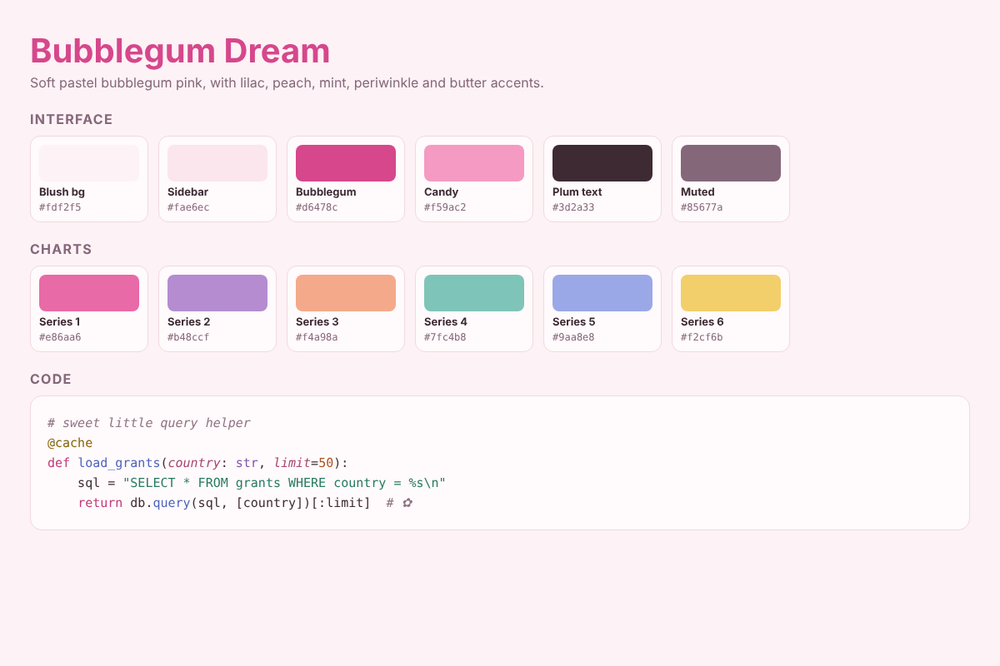

# Bubblegum Dream

A soft pastel bubblegum-pink theme set, with lilac, peach, mint, periwinkle and butter accents.



| App | File | How to install |
| --- | --- | --- |
| VS Code | `vscode/bubblegum-dream-1.0.0.vsix` | Extensions → `···` → **Install from VSIX…**, then **Ctrl + K, Ctrl + T** → *Bubblegum Dream* |
| Windows Terminal | `windows-terminal/bubblegum-dream.json` | See below |
| GNOME Terminal | `gnome-terminal/install.sh` | `./gnome-terminal/install.sh` (add `--default` to make it your default profile) |
| Apache Superset | `superset/bubblegum-dream.json` | **Settings → Themes → + Theme**, paste the file, save |
| Web pages / dashboards | `web/bubblegum-dream.css` | `<link rel="stylesheet" href="bubblegum-dream.css">`, then use `var(--bd-accent)` etc. |
| Chart palettes | `web/bubblegum-dream-charts.json` | 12 pastel series colors, pink first |

## Windows Terminal

1. Press **Ctrl + Shift + ,** to open `settings.json`.
2. Paste the contents of `windows-terminal/bubblegum-dream.json` into the `"schemes": [ ... ]` list.
3. In your profile (or `"defaults"`), set `"colorScheme": "Bubblegum Dream"` and save.

## GNOME Terminal

```bash
./gnome-terminal/install.sh            # adds a "Bubblegum Dream" profile
./gnome-terminal/install.sh --default  # ...and makes it the default
```

The script adds a new profile and leaves your existing profiles alone.

## Superset

Paste `superset/bubblegum-dream.json` into a new theme. If your Superset version rejects the theme,
remove the `echartsOptionsOverrides` block (the chart colors) and save again. To apply it to one dashboard,
edit the dashboard and pick the theme from its theme dropdown.

## Palette

| Role | Color |
| --- | --- |
| Bubblegum (primary) | `#d6478c` |
| Candy (light pink) | `#f59ac2` |
| Blush background | `#fdf2f5` |
| Plum text | `#3d2a33` |
| Lilac | `#b48ccf` |
| Peach | `#f4a98a` |
| Mint | `#7fc4b8` |
| Periwinkle | `#9aa8e8` |
| Butter | `#f2cf6b` |

Code colors are darker versions of these accents so every one reads clearly (WCAG AA) on the blush background.

## Changing colors

Every file is generated from `palette.json`. Edit it, then run:

```bash
python3 build.py
cd vscode && npx @vscode/vsce package --allow-missing-repository
```

## License

MIT
